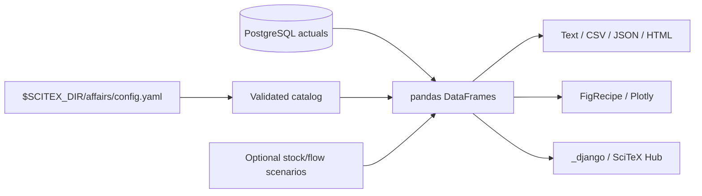

# scitex-affairs (`scitex-affairs`)

<p align="center">
  <a href="https://scitex.ai">
    
  </a>
</p>

<p align="center"><b>One source for business and personal affairs: catalogs, actuals, reports, and optional time-aware scenarios.</b></p>

<p align="center">
  <a href="https://scitex-affairs.readthedocs.io/">Full Documentation</a> · <code>uv pip install scitex-affairs[all]</code>
</p>

<!-- scitex-badges:start -->
<p align="center">
  <a href="https://pypi.org/project/scitex-affairs/"></a>
  <a href="https://pypi.org/project/scitex-affairs/"></a>
  <a href="https://scitex-affairs.readthedocs.io/en/latest/"></a>
</p>
<p align="center">
  <a href="https://github.com/scitex-ai/scitex-affairs/actions"></a>
  <a href="https://github.com/scitex-ai/scitex-affairs/actions"></a>
  <a href="https://github.com/scitex-ai/scitex-affairs/actions"></a>
  <a href="https://codecov.io/gh/scitex-ai/scitex-affairs"></a>
</p>
<!-- scitex-badges:end -->

---

## Problem and Solution

| Problem | Solution |
|---|---|
| Prices drift across spreadsheets, HTML, and apps | Validate one small YAML catalog |
| A year-end subscriber target is incorrectly billed for all 12 months | Interpolate the stock through time and bill monthly averages |
| Month, quarter, and year formats are rebuilt by hand | Derive every period from one canonical monthly pandas report |
| Forecasts crowd out today's facts | Keep scenarios optional and actual observations append-only |

## Quick Start

```bash
uv pip install scitex-affairs[all]
scitex-affairs config validate
scitex-affairs catalog show --format markdown
```

## Installation

```bash
uv pip install scitex-affairs[all]

# Local development
uv pip install -e ~/proj/scitex-affairs
```

The base package owns the data model and pandas descriptions. The `[all]`
extra is the normal end-user install: it adds plotting (FigRecipe, Plotly)
and the development tools.

## Usage

The default config path is `$SCITEX_DIR/affairs/config.yaml`, normally
`~/.scitex/affairs/config.yaml`. The shared `scitex-config` local-state
primitive resolves it; an explicit `--config` or
`SCITEX_AFFAIRS_CONFIG` override remains available.

```bash
scitex-affairs config validate
scitex-affairs catalog show --format markdown
scitex-affairs app serve --no-open-browser
```

```python
from scitex_affairs import catalog_frame, load_config

config = load_config()
catalog = catalog_frame(config)
```

Forecasts are deliberately optional. If a scenario is useful, point-in-time
customers or subscriptions are `stock` measures; projects and usage totals are
`flow` measures. The engine integrates daily values into monthly results
before fiscal-quarter or fiscal-year aggregation.

## Prices in Another Currency

A price can be set in its own currency (the SciTeX price list is in USD) while plans and accounts stay in the config's `currency`. Amounts are converted at a live rate fetched from the declared reference source:

```yaml
currency: JPY                  # plans and accounts are kept in yen
fx:
  provider: open.er-api.com    # ExchangeRate-API, the source scitex.ai also uses
catalog:
  - id: subscription-general
    name: SciTeX Cloud Standard
    direction: revenue
    model: recurring
    price: {kind: fixed, amount: 39, currency: USD, interval: month, unit: person}
```

Every converted row records `price_currency`, `fx_rate`, `fx_as_of` and `fx_source`. A price in another currency without `fx.provider` is a config error, and a rate that cannot be fetched raises `FxError`: there is no fallback rate. Converted figures are **estimates**: actual billing is in the price's own currency, and an amount charged in another currency is set by the card issuer's rate and fees at settlement. `scitex_affairs.fx.disclosure(rate, 'en' | 'ja')` renders that statement; `scitex-affairs scenario report` prints it whenever a conversion was used.

## Architecture



<sub><b>Figure 1.</b> One validated data layer feeds every reporting surface.</sub>

There is one calculation engine. The CLI, plots, standalone app, and Hub
adapter render its DataFrames and do not maintain independent prices or
formulas.

## 4 Interfaces

1. Python: `load_config`, `catalog_frame`, `monthly_report`, and `summarize`.
2. CLI: `config`, `catalog`, `scenario`, `observations`, and `app` noun groups.
3. SciTeX App: the thin `scitex_affairs._django` standalone/Hub adapter.
4. Skills: packaged only under `src/scitex_affairs/_skills/scitex-affairs/`.

The skill includes reusable procurement screening, business contest preparation,
and presentation revision workflows. Company qualifications, templates, private
feedback, financial records, and submission evidence stay in the user's private
workspace. The package contains methods and tools, not an applicant profile.

## PostgreSQL Actuals

`scitex_affairs.actuals` registers the `affairs_actuals` plugin with
`scitex_dev.store`. `scitex-dev` alone resolves the target through
`SCITEX_STORE_DSN` or the host PostgreSQL service. This package has no SQLite
fallback and contains no deployment hostname or password.

## Environment Variables

| Variable | Purpose |
|---|---|
| `SCITEX_DIR` | Relocate the ecosystem user root from `~/.scitex` |
| `SCITEX_AFFAIRS_CONFIG` | Override the resolved business YAML |
| `SCITEX_STORE_DSN` | Standard `scitex-dev` PostgreSQL target override |

<sub><b>Table 1.</b> Environment variables are owned by the package shown in their descriptions.</sub>

## Development

```bash
ruff check .
python -m pytest
python -m build
scitex-app app validate src/scitex_affairs/_django
```

See [CONTRIBUTING.md](CONTRIBUTING.md), [CHANGELOG.md](CHANGELOG.md), and
[CLA.md](CLA.md).

## Part of SciTeX

`scitex-affairs` is part of [SciTeX](https://scitex.ai).

> Four Freedoms for Research
>
> 0. The freedom to **run** your research anywhere — your machine, your terms.
> 1. The freedom to **study** how every step works — from raw data to final manuscript.
> 2. The freedom to **redistribute** your workflows, not just your papers.
> 3. The freedom to **modify** any module and share improvements with the community.
>
> AGPL-3.0 — because we believe research infrastructure deserves the same freedoms as the software it runs on.

---

<p align="center">
  <a href="https://scitex.ai"></a>
</p>
